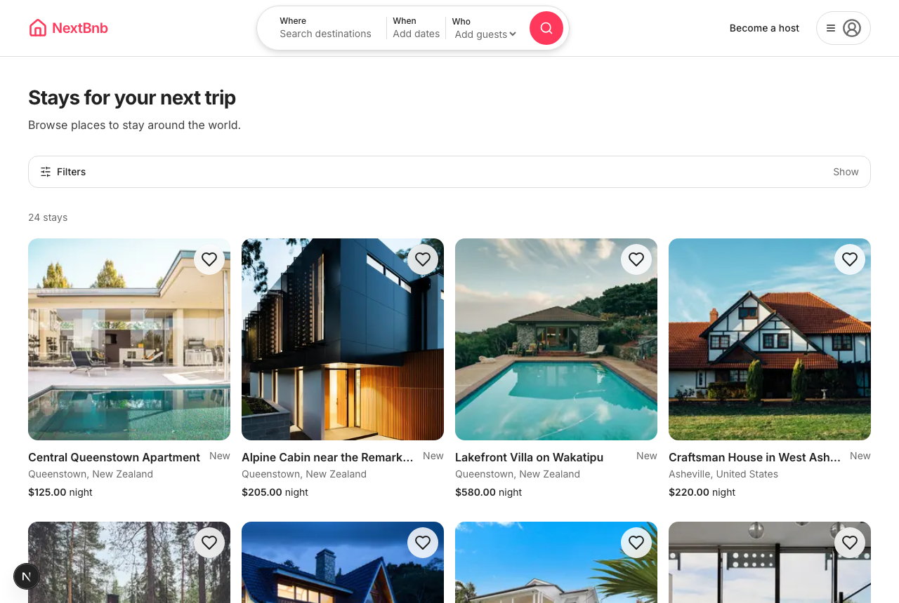
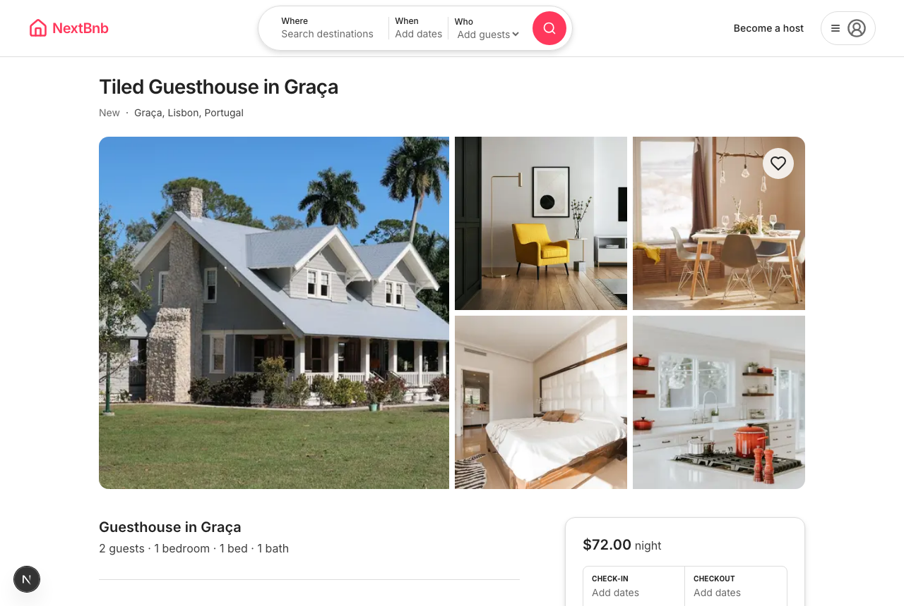
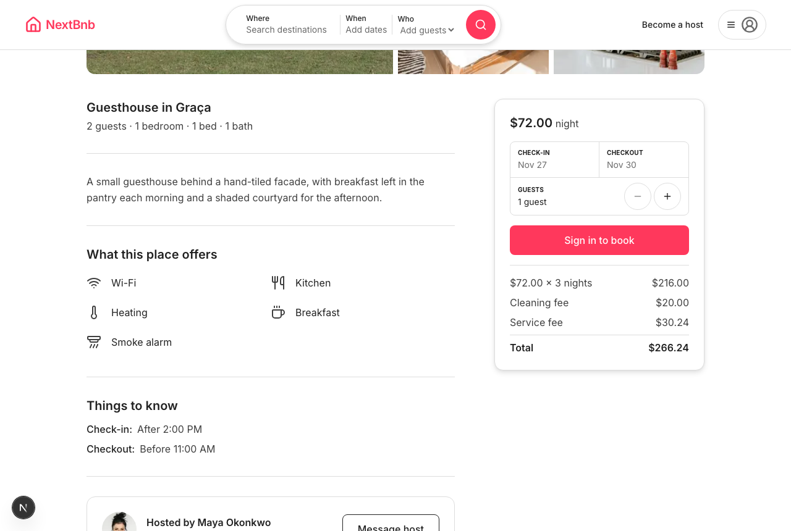
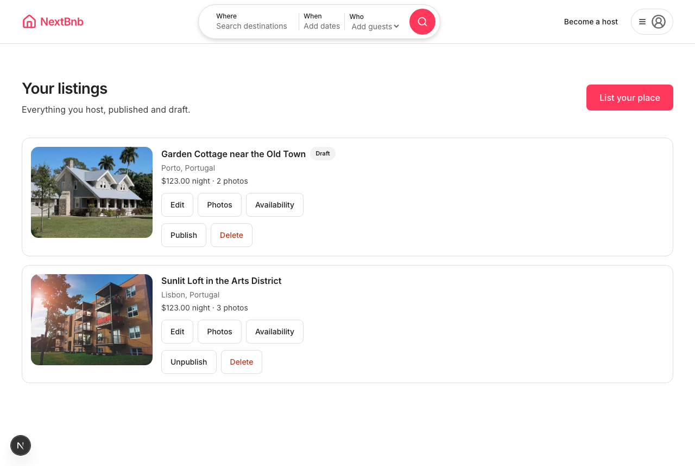
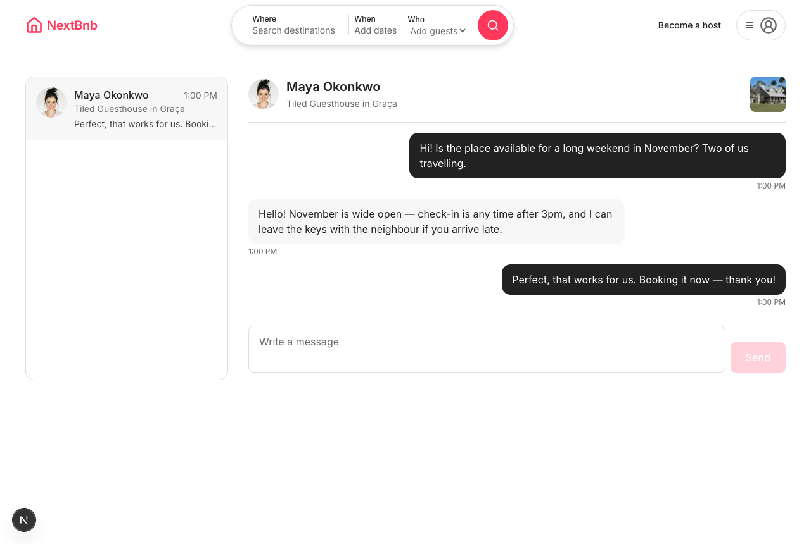
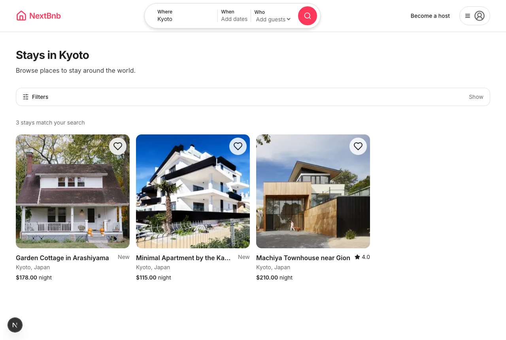
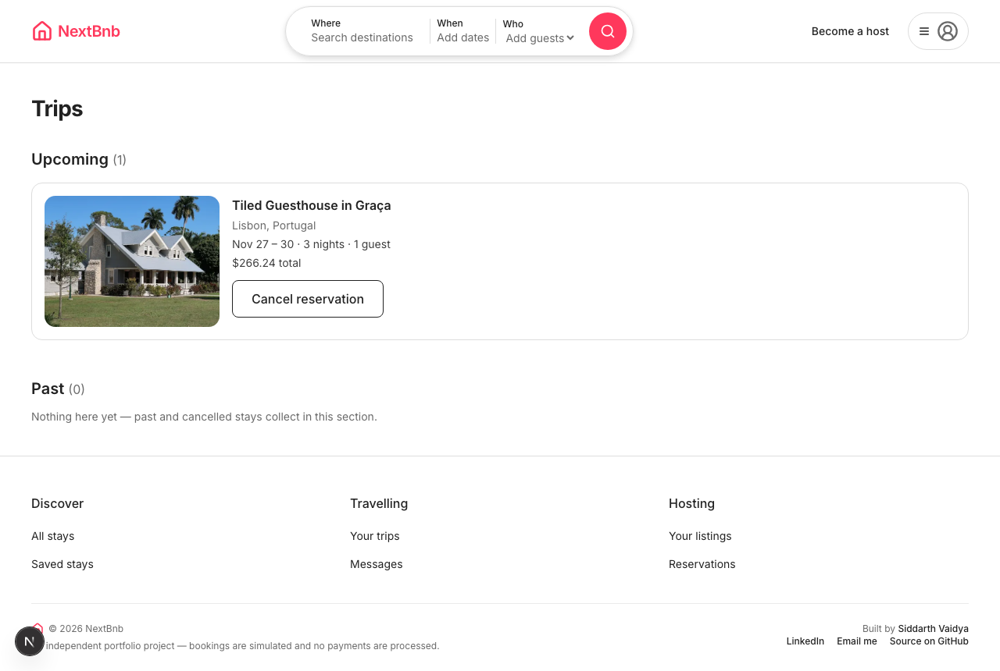
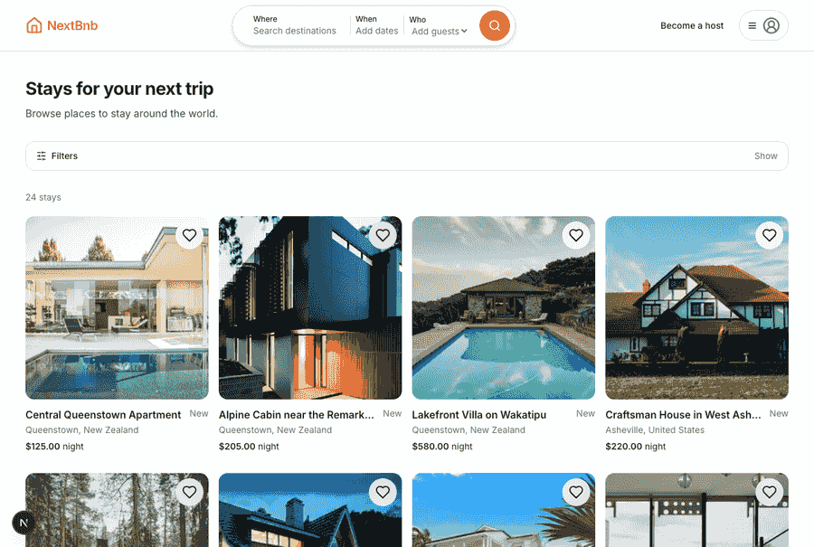
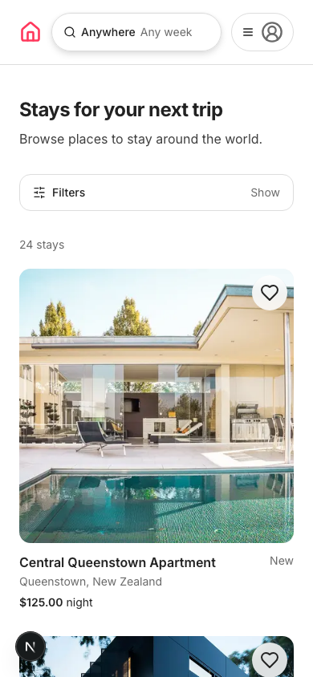
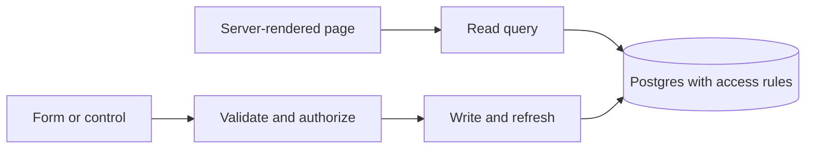

# NextBnb


NextBnb is a full-stack marketplace for short-term stays. Guests can find a place, check available dates and reserve it. Any signed-in user can also host: create a listing, upload photos, set a price and manage availability.

Bookings are confirmed immediately. This is a portfolio project: no payment is taken.

[Open the demo](https://nextbnb-h4ov.onrender.com)

The deployment notes describe Render's free service tier and a cold start of about 30 seconds after idle periods; allow the demo time to wake up.



## What you can do

Search by destination, dates, guest count, price, property type and amenities. Filters stay in the URL, so you can share a search or reload without losing it. Open a listing for its gallery, amenities, house rules, host information and reviews.

Choose dates and guests to see the full price before reserving. Trips keeps upcoming and past stays together; eligible cancellations free the dates. Save places to Favorites, message a host, and leave a review after a completed stay.

Hosts can create drafts, manage photos and their order, publish or unpublish listings, block dates and inspect incoming reservations. A separate admin dashboard provides moderation over users, listings and bookings.

## Screenshots

<table>
  <tr>
    <td width="50%"><br><em>Listing details</em></td>
    <td width="50%"><br><em>Booking and price breakdown</em></td>
  </tr>
  <tr>
    <td width="50%"><br><em>Host listings</em></td>
    <td width="50%"><br><em>Messages</em></td>
  </tr>
  <tr>
    <td width="50%"><br><em>Filtered search</em></td>
    <td width="50%"><br><em>Trips</em></td>
  </tr>
</table>

The booking flow goes from search to date selection, reservation and Trips:



<details>
<summary>Mobile layout</summary>

The interface has phone, tablet, laptop and wide layouts. Search opens an overlay on phones, while booking uses a bottom bar and sheet.



</details>

## How it is built

| Area | Tools and purpose |
| --- | --- |
| Application | Next.js 16 App Router and React 19 render pages and handle server operations |
| Types | TypeScript in strict mode; database types are generated from the schema |
| Styling | Tailwind CSS v4 with shared colors, spacing and breakpoints; Inter for type |
| Database | Supabase Postgres stores listings, bookings, profiles and conversations |
| Access | Row Level Security restricts records; column grants restrict sensitive fields |
| Sign-in | Supabase Auth with Google OAuth and cookie sessions |
| Messages | Supabase Realtime delivers new messages to an open conversation |
| Images | Cloudinary handles signed uploads and responsive delivery; seed photos use Unsplash URLs |
| Forms and validation | Zod 4 and react-hook-form share input rules between forms and server actions |
| Dates | date-fns supports calendar-date calculations |
| Tests | Vitest, Playwright and SQL verification scripts |
| Hosting | Render runs the production Node service |

A page reads through a server-only query. A form writes through a server action, which validates the input, checks the user, applies the change and refreshes affected pages. Database access rules apply underneath both paths.



The boundaries have specific homes: `src/lib/queries/` holds page reads, `src/lib/actions/` holds writes, and `src/lib/supabase/` constructs clients. Reusable UI lives in `src/components/ui/`. The [Architecture guide](context/architecture.md) explains the contracts and their exceptions.

Several rules need more than a disabled button. The database rejects overlapping confirmed bookings. Prices are stored as whole cents and saved with each reservation, so a host changing tomorrow's rate cannot change an existing booking. The checkout day is available for another arrival; host-blocked ranges include both endpoints.

Public profiles contain names and avatars, not email addresses. Row policies and column privileges work together so updating a profile cannot promote an account to admin. Narrow database helpers expose availability without revealing other guests' booking records. The privileged service-role key is confined to standalone setup scripts.

## Run locally

You need Node.js ≥20.9, npm, a Supabase project, a Google OAuth client and a Cloudinary account. `.nvmrc` selects Node 20. Dependency versions are recorded in the manifest and lockfile.

```bash
nvm use
npm install
cp .env.example .env.local
```

Fill in `.env.local`, apply the nine SQL files in `supabase/migrations/` in filename order, and run `supabase/seed.sql` if you want the sample catalogue. Then start the app:

```bash
npm run dev
```

Open `http://localhost:3000`.

The seed creates 26 sample listings, 130 photos and demo users. Running it again replaces its five sentinel demo users and their related data. Real accounts are preserved, but a manually created booking on a demo listing can be removed by that cascade. Read the seed's comments before rerunning it against data you want to keep.

### Configuration

| Variable | Purpose |
| --- | --- |
| `NEXT_PUBLIC_SUPABASE_URL` | Supabase project URL |
| `NEXT_PUBLIC_SUPABASE_ANON_KEY` | Public key used with database access policies |
| `SUPABASE_SERVICE_ROLE_KEY` | Secret for standalone seed/migration scripts; never application requests |
| `NEXT_PUBLIC_SITE_URL` | App origin, such as `http://localhost:3000`, without the callback path |
| `NEXT_PUBLIC_CLOUDINARY_CLOUD_NAME` | Cloudinary account name |
| `CLOUDINARY_API_KEY` | Public account identifier used by server configuration |
| `NEXT_PUBLIC_CLOUDINARY_API_KEY` | The same identifier for the browser upload widget |
| `CLOUDINARY_API_SECRET` | Secret used only by the server to sign uploads |

The Cloudinary API key is a public identifier. The API secret authorizes signing and stays on the server. The signing endpoint checks the user and listing ownership before returning a signature. See [Environment variables](context/code-standards.md#environment-variables) for the project rules.

### Commands

| Command | Purpose |
| --- | --- |
| `npm run dev` | Local development server |
| `npm run build` | Production build |
| `npm run start` | Serve the production build |
| `npm run typecheck` | TypeScript checks |
| `npm run lint` | ESLint |
| `npm run test` | Vitest tests |
| `npm run test:e2e` | Playwright tests using the configured database |
| `npm run check:context` | Check documentation links, decision records and reading cost |
| `npm run test:context` | Test the documentation checker against deliberate failures |

## Verification

The last recorded product run, on 2026-07-30, had 288 passing unit tests and 420 E2E tests: 417 passed, three skipped and none failed. The test badge is a static record of those totals, not a live CI result. The older production-mode baseline covered 395 E2E tests. Those suites were not rerun for this documentation rewrite.

The tests cover pricing and date calculations, validation, ownership boundaries and the main user flows. Ownership tests use two identities, and new assertions are checked against deliberately broken behavior before being trusted. Periodic production-mode runs matter: one host-listing refresh defect appeared there while development-mode tests stayed green.

Current baselines, qualifications and remaining work are in the [Progress tracker](context/progress-tracker.md).

## Deployment

The committed `render.yaml` defines a Render Web Service. It builds with `npm run build` and starts with `npm start`. Follow the [Render runbook](docs/deploy-render.md) for environment configuration, redirect registration and deployment checks.

Google's redirect goes to Supabase; Supabase's allowed return URL goes to this app. `NEXT_PUBLIC_SITE_URL` must be the app origin. Public environment values are compiled into the build, so changing one requires another deployment.

## Project documentation

Start with the [Project overview](context/project-overview.md) for behavior and scope, then [Architecture](context/architecture.md) for the implementation. [Code standards](context/code-standards.md) and the [Design system](context/DESIGN.md) explain how to change it consistently. The [Progress tracker](context/progress-tracker.md) holds status and open work.

The [Build record](context/build-plan.md) explains the original 18 features. The journal preserves the dated build history, including failed diagnoses and corrections. Detailed pre-rewrite notes remain in the [Reference index](docs/reference/README.md). `CLAUDE.md` is the repository's single agent entry point.

## Scope and license

The project deliberately excludes real payments, maps/geocoding, notifications, host-approved bookings, multiple currencies/languages and native mobile apps. It is licensed under [MIT](LICENSE), © 2026 Siddarth Vaidya.

Sample photography comes from [Unsplash](https://unsplash.com) under the Unsplash License. NextBnb is an independent portfolio project and is not affiliated with or endorsed by Airbnb, Inc.
