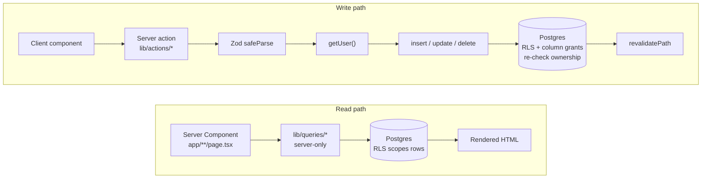
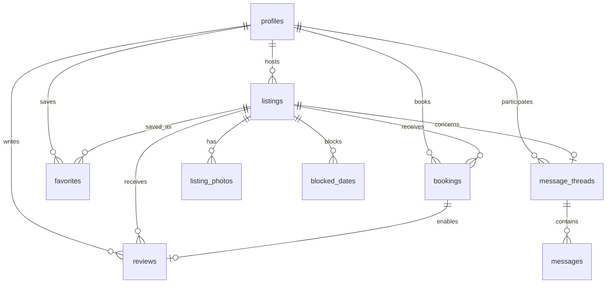

# NextBnb


A full-stack short-term rental marketplace. Guests search stays by destination, dates,
group size, price, property type and amenities, then book instantly. Any signed-in user can
become a host: create listings, upload photos, set pricing and availability, and manage
incoming reservations. Guests and hosts message each other in real time, and guests review
stays once they finish.

**Live demo → [nextbnb-h4ov.onrender.com](https://nextbnb-h4ov.onrender.com)**

> Hosted on Render's free tier, which spins the service down when idle. The first request
> after a quiet period takes about 30 seconds to wake; subsequent requests are immediate.


---

## Features

**Discovery and booking**

- Search by destination, check-in/check-out dates, guest count, price range, property type and amenities, in any combination. Filter state lives in the URL, so any search is shareable and survives a reload.
- Listing pages with a photo gallery, amenities, house rules, check-in times, host details and reviews.
- Instant Book: pick dates and guests, see a live price breakdown, and get a confirmed reservation. No payment is taken.
- Favorites, and a Trips view of upcoming and past stays with cancellation that frees the dates.
- Ratings and reviews, limited to one per completed stay, aggregated into each listing's average.

**Hosting**

- Create, edit, publish, unpublish and delete listings.
- Signed, direct-to-CDN photo uploads with a per-listing gallery and cover image.
- Block date ranges to manage availability alongside real bookings.
- See incoming reservations across every listing you host, with per-stay earnings.

**Communication and administration**

- Guest ↔ host messaging with live message delivery over Postgres change streams.
- Moderation dashboard over users, listings and bookings, reachable only by flagged admins.

---

## Screenshots

<table>
  <tr>
    <td width="50%"><br><em>Listing detail — gallery, amenities, host card</em></td>
    <td width="50%"><br><em>Booking widget — live price breakdown</em></td>
  </tr>
  <tr>
    <td width="50%"><br><em>Host dashboard — published and draft listings</em></td>
    <td width="50%"><br><em>Messaging — realtime guest ↔ host threads</em></td>
  </tr>
  <tr>
    <td width="50%"><br><em>Search — filtered, URL-driven results</em></td>
    <td width="50%"><br><em>Trips — upcoming and past stays</em></td>
  </tr>
</table>

**The booking flow, end to end** — browse, pick dates, reserve, and the stay appears under Trips:


<details>
<summary>Mobile layout</summary>

Every screen is built mobile-first and verified at four breakpoints — phone (`<744px`),
tablet (`744–1128px`), laptop (`1128–1440px`) and wide (`>1440px`). Grids drop columns
rather than reflowing rows.


</details>

---

## Tech stack

| Layer | Choice | Why |
| ----- | ------ | --- |
| Framework | Next.js 16 (App Router) | Server Components for reads and server actions for writes, so data access stays on the server |
| Language | TypeScript 5.7, `strict` | No implicit `any`; row types are generated from the database schema rather than hand-written |
| UI | React 19 | Client components kept small and at the leaves |
| Styling | Tailwind CSS v4 | Design tokens declared once in a `@theme` block and consumed as utilities |
| Database | Supabase Postgres | Relational store with constraints doing real work, not just storage |
| Authorization | Postgres Row Level Security | Per-user ownership enforced in the database, plus column-level grants |
| Auth | Supabase Auth, Google OAuth (PKCE) | Cookie-based sessions via `@supabase/ssr`, refreshed in the proxy |
| Realtime | Supabase Realtime | Postgres change streams for live message delivery |
| Images | Cloudinary via `next-cloudinary` | Server-signed uploads; `f_auto`/`q_auto` responsive delivery |
| Validation | Zod 4 | One schema validates the form and the server action it posts to |
| Forms | react-hook-form | Bound to the same Zod schemas through `@hookform/resolvers` |
| Dates | date-fns | Calendar-day arithmetic that matches the database's date ranges |
| Testing | Vitest, Playwright | Unit tests for pure logic; end-to-end tests for every core flow |
| Hosting | Render (Web Service) | `npm run build` → `npm start` |

---

## Architecture

Reads and writes take deliberately different paths. Reads render on the server; writes go
through a server action that validates, authorizes, mutates and revalidates — in that order.



Module boundaries are enforced rather than conventional:

- **`src/lib/supabase/`** is the only place a Supabase client is constructed — one factory per runtime, server and browser.
- **`src/lib/queries/`** holds every read. Each module starts with `import 'server-only'`, so a client import fails at build time.
- **`src/lib/actions/`** holds every write. Components never touch the database directly.
- **`src/components/ui/`** contains presentational primitives only: no data fetching, no business rules.
- **`src/lib/cloudinary.ts`** is the only module holding the Cloudinary secret, and is likewise `server-only`.

The App Router serves 13 pages and 2 route handlers (the OAuth callback and the Cloudinary
signing endpoint). Request-level session refresh and route guarding live in `src/proxy.ts` —
Next.js 16's replacement for the `middleware` convention.

<details>
<summary>Data model — 9 tables</summary>

All monetary amounts are integers in cents. Availability is derived from `bookings` and
`blocked_dates`; it is never a stored flag.



`profiles` deliberately has **no email column**: it is publicly readable so host and
reviewer names can render, and an email column there would expose every user's address.
Email lives in `auth.users` and is reachable only by the account itself or through a
narrowly-scoped admin function.

</details>

---

## Security model

Authorization is enforced in Postgres, not in application code. Row Level Security is
enabled on all 9 tables and is the authority for every read and write; the `getUser()` check
in each server action improves the user experience but is not the guard.

**Row Level Security does not filter columns.** A row-level policy accepts or rejects a
whole row, so "may update their own profile" would also accept `is_admin = true`. Rules of
that shape are carried by column-level `GRANT`s alongside the policies:

| Table | Columns `authenticated` may write |
| ----- | -------------------------------- |
| `profiles` | `full_name`, `avatar_url` — never `is_admin`, so self-promotion is impossible |
| `bookings` | `status`, `cancelled_at` — dates and the price snapshot are unwritable |
| `message_threads` | `last_message_at` |
| `messages` | `read_at` — message bodies can never be edited |

Where the matrix says "no one", the privilege is revoked outright rather than left to the
absence of a policy: an `UPDATE` against an RLS-protected table with no matching policy
affects zero rows **and reports success**, which is indistinguishable from working.

Four `security definer` functions bypass RLS. Each exists for a stated reason, returns the
narrowest useful shape, and is hardened the same way — `set search_path = ''`, fully
qualified references, and `EXECUTE` revoked from `PUBLIC`:

| Function | Reaches | Returns |
| -------- | ------- | ------- |
| `admin_list_users()` | `auth.users.email`, which `profiles` cannot hold | `(id, email)` only; self-guarded on `is_admin()` |
| `unavailable_listing_ids(in, out)` | `bookings` rows an anonymous visitor cannot see | Published listing ids only |
| `listing_occupied_ranges(id)` | The same, per listing, for the date picker | Inclusive date spans, published listings only |
| `admin_unpublish_listing(id)` | The `listings` UPDATE policy, which has no admin branch | Writes `is_published` and no other column |

That last one is the interesting case. An admin can read and delete a listing but **cannot
update one** — the update policy names only the host. Widening it would have handed admins
every listing column including `host_id`, since no column grant restricts listing writes, so
the capability ships as a function that can change exactly one field.

The privileged service-role key is confined to standalone seed and migration scripts. It
never appears in a request path — not in a route handler, a server action, or a Server
Component.

---

## Correctness guarantees

Each of these is enforced by a database constraint or policy, not only by application code:

- **Two confirmed bookings can never overlap on the same listing.** A `btree_gist` exclusion constraint forbids overlapping `daterange(check_in, check_out, '[)')` for a listing while `status = 'confirmed'`. The booking action checks availability first and translates the constraint's `23P01` into a plain message, so the constraint is the backstop rather than the error path.
- **Money is integer cents everywhere.** Fees round half-up to whole cents; no floating-point currency is stored or calculated.
- **A booking's prices are a snapshot.** `nights`, `price_per_night`, `cleaning_fee`, `service_fee` and `total` are written once at creation and never recomputed from the listing afterwards, so later price changes cannot rewrite history.
- **Availability is derived, never stored** — confirmed bookings unioned with host-blocked ranges. Bookings are half-open `[check_in, check_out)`, so a guest may check in on another's checkout day; blocked ranges are inclusive at both ends.
- **Availability is resolved in the database.** RLS hides `bookings` from anonymous visitors, so computing it in application code would conclude that everything is free — silently, and without an error. Every availability check goes through a definer function instead.
- **A host cannot book their own listing**, enforced in the action and in the `bookings` insert policy.
- **One review per booking**, by that booking's guest, and only after checkout has passed. A unique constraint on `booking_id` makes duplicates impossible; reviews have no update policy, so they are immutable.
- **Unpublished listings are invisible** to everyone except their host and admins, enforced in the read policy rather than in the query.

---

## Testing

| Suite | Count | Covers |
| ----- | ----- | ------ |
| Vitest (unit) | **288** across 6 files | Price breakdown and fee rounding, night counting, availability and overlap helpers, and every Zod schema |
| Playwright (E2E) | **405** across 28 spec files | Auth gates, search and filters, booking and cancellation, hosting, availability, reviews, messaging, admin, keyboard access, and responsive layout at every breakpoint |
| SQL verification | 2 scripts | Schema, RLS policies and grants; seeded data shape, asserted before the E2E suite runs |

Most recent full run: 402 passed, 3 skipped, 0 failed.

Four practices matter more than the totals:

- **Every new test is proven to fail before it is trusted.** A test is run against a deliberately broken build first — the guard deleted, the attribute removed — and only counts once it has failed for the right reason. This caught several assertions that passed against markup that did not work, including an accessibility test matching an attribute rather than the accessible name a screen reader computes.
- **Two fixture accounts, not one.** Any behaviour that depends on *who is asking* cannot be verified by a single identity: one account is always the owner of what it edits, so it can only ever ask the reassuring half of each RLS question.
- **The suite is run against a production build periodically**, not only against the dev server. Streaming, prefetching and caching differ between them, and one whole class of defect is invisible to a dev-server-only strategy.
- **Test-created data cleans up after itself**, with a global teardown as the backstop for runs that die early, so counts stay meaningful between runs.

---

## Getting started

### Prerequisites

- **Node.js ≥ 20.9** (LTS) and **TypeScript ≥ 5.1** — both are Next.js 16 minimums. The repo pins Node via `.nvmrc` and `engines`.
- A **Supabase** project, a **Google OAuth** client, and a **Cloudinary** account. All three have free tiers sufficient to run this.

### Setup

```bash
nvm use                      # Node 20, from .nvmrc
npm install
cp .env.example .env.local    # fill in the values below
npm run dev                   # http://localhost:3000
```

The app needs a provisioned database before it will show anything:

1. Apply the migrations in `supabase/migrations/` (9 files, in order).
2. Run `supabase/seed.sql` for 26 sample listings, 130 photos and demo users.

> `seed.sql` starts by deleting its own five sentinel demo users by id, cascading their
> listings, bookings and reviews. Real accounts are never touched. It will, however, remove
> rows you created by hand that hang off seeded data — a booking you made against a demo
> listing goes with it.

### Environment variables

Set these in `.env.local` for development and in the Render dashboard for production. The
full rationale for each is in `context/code-standards.md`.

| Variable | Secret | Purpose |
| -------- | ------ | ------- |
| `NEXT_PUBLIC_SUPABASE_URL` | no | Supabase project URL |
| `NEXT_PUBLIC_SUPABASE_ANON_KEY` | no | Anonymous key; every request it makes is RLS-scoped |
| `SUPABASE_SERVICE_ROLE_KEY` | **yes** | Bypasses RLS. Seed and migration scripts only, never a request path |
| `NEXT_PUBLIC_SITE_URL` | no | Base for the OAuth `redirectTo` |
| `NEXT_PUBLIC_CLOUDINARY_CLOUD_NAME` | no | Image delivery |
| `CLOUDINARY_API_KEY` | no | Public account identifier used by the server SDK |
| `NEXT_PUBLIC_CLOUDINARY_API_KEY` | no | The same value, needed in the browser by the upload widget |
| `CLOUDINARY_API_SECRET` | **yes** | Signs uploads server-side |

Cloudinary's `api_key` is a public identifier that accompanies every browser upload, which
is why it is also exposed as a `NEXT_PUBLIC_` variable. The `api_secret` is what actually
authorizes an upload, and it never leaves the server: the signing route verifies the
session, whitelists the signable parameters, and confirms the target folder belongs to a
listing the caller hosts before signing anything.

### Scripts

| Command | Purpose |
| ------- | ------- |
| `npm run dev` | Development server |
| `npm run build` / `npm run start` | Production build / serve |
| `npm run lint` | ESLint |
| `npm run typecheck` | `tsc --noEmit` |
| `npm run test` | Vitest unit and component tests |
| `npm run test:e2e` | Playwright end-to-end tests |

---

## Deployment

Deployed to Render as a Web Service using the committed `render.yaml` blueprint. The full
runbook is in **[`docs/deploy-render.md`](docs/deploy-render.md)**. Two things are worth
knowing before the first deploy:

- **Redirect URLs are registered in three separate places** — the Google Cloud OAuth client points at Supabase, Supabase's URL configuration points back at this app, and the app builds its own callback from `NEXT_PUBLIC_SITE_URL`. Missing any one of them breaks sign-in in a different way.
- **`NEXT_PUBLIC_*` values are inlined at build time**, so setting the site URL requires a second deploy once the service has a hostname, and no runtime check can detect a stale one. The runbook shows how to probe the artifact the value produces instead.

---

## How this project is documented

The `context/` directory, not the source, is this project's reference material, and it is
maintained as the code changes:

| File | Holds |
| ---- | ----- |
| `project-overview.md` | What the product is, who it serves, what is in and out of scope |
| `architecture.md` | Stack, module boundaries, data model, and the invariants that must not be violated |
| `code-standards.md` | The rules every change follows — language, framework, naming, error handling |
| `library-docs.md` | Project-specific usage patterns for each dependency |
| `progress-tracker.md` | Live status, current verification baselines, and open work |
| `build-journal.md` | A dated entry per feature, plus the constraints that still bind |
| `DESIGN.md` | The visual system: tokens, component specs, breakpoints |

Two conventions do the real work. **Verification baselines are recorded, and a deviation is
treated as a finding rather than a number to overwrite** — every gate has a current value,
and work that moves one has to explain why. **Wrong turns are corrected in place, never
deleted**: when a recorded diagnosis turns out to be false, the original stays with a dated
correction beneath it, because a confidently wrong note costs more than no note — it tells
every later reader where not to look. Several of the most useful entries in the journal are
records of hypotheses that failed.

---

## Scope

Deliberately not built, to keep the project focused on the marketplace itself:

- **Real payments.** Bookings are confirmed instantly and no money moves; no card details are collected.
- **Maps and geocoding.** Location is text only — no coordinates, no map view.
- **Notifications.** No transactional email, SMS or push.
- **Request-to-book.** All reservations are Instant Book; there is no host approval step.
- **Multi-currency and internationalization.** One currency, one locale.
- **Native mobile apps.** Responsive web only.

Known limitations and remaining open work are tracked in
[`context/progress-tracker.md`](context/progress-tracker.md).

---

## License

[MIT](LICENSE) © 2026 Siddarth Vaidya

Sample listing photography comes from [Unsplash](https://unsplash.com) under the Unsplash
License. NextBnb is an independent portfolio project, not affiliated with or endorsed by
Airbnb, Inc.
